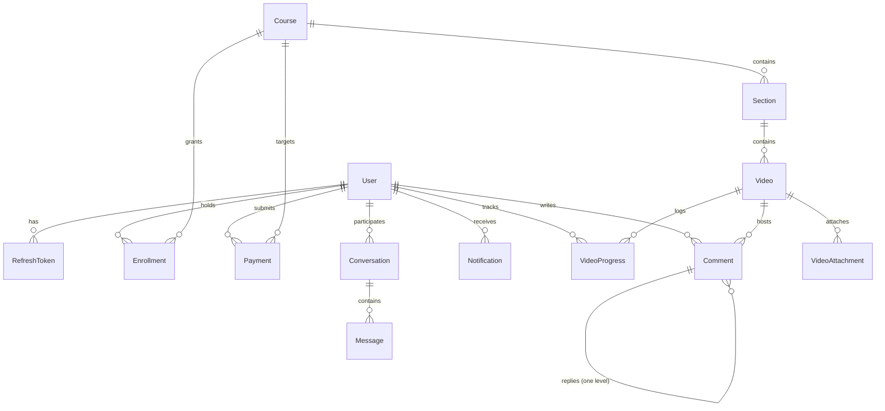

# Data Model Specification: Zizo LMS

**Feature Branch**: `001-zizo-lms`  
**Spec Reference**: `specs/001-zizo-lms/spec.md`  
**Constitution Reference**: `.specify/memory/constitution.md`

---

## 1. Entity Relationship Overview

The domain model cleanly separates course catalog structure, authentication lifecycles, manual payment audit records, access entitlements, communication channels, and student progress tracking.



---

## 2. Complete Prisma Schema Definition

```prisma
datasource db {
  provider = "postgresql"
  url      = env("DATABASE_URL")
}

generator client {
  provider = "prisma-client-js"
}

enum Role {
  ADMIN
  STUDENT
}

enum CourseStatus {
  DRAFT
  PUBLISHED
}

enum PaymentStatus {
  PENDING
  APPROVED
  DECLINED
}

enum NotificationType {
  PAYMENT_APPROVED
  PAYMENT_DECLINED
  NEW_COMMENT_REPLY
  NEW_CHAT_MESSAGE
  SYSTEM_ANNOUNCEMENT
}

model User {
  id            String         @id @default(uuid())
  email         String         @unique
  passwordHash  String
  name          String
  role          Role           @default(STUDENT)
  createdAt     DateTime       @default(now())
  updatedAt     DateTime       @updatedAt

  refreshTokens RefreshToken[]
  enrollments   Enrollment[]
  payments      Payment[]      @relation("StudentPayments")
  reviewedPayments Payment[]   @relation("AdminReviewedPayments")
  comments      Comment[]
  notifications Notification[]
  progress      VideoProgress[]
  
  // Conversations as student or admin
  studentConversations Conversation[] @relation("StudentConversations")
  adminConversations   Conversation[] @relation("AdminConversations")
  messagesSent         Message[]

  @@index([email])
}

model RefreshToken {
  id        String   @id @default(uuid())
  userId    String
  token     String   @unique
  expiresAt DateTime
  revoked   Boolean  @default(false)
  createdAt DateTime @default(now())

  user User @relation(fields: [userId], references: [id], onDelete: Cascade)

  @@index([userId])
  @@index([token])
}

model Course {
  id           String       @id @default(uuid())
  title        String
  slug         String       @unique
  description  String?      @db.Text
  price        Decimal      @db.Decimal(10, 2)
  thumbnailKey String?
  status       CourseStatus @default(DRAFT)
  createdAt    DateTime     @default(now())
  updatedAt    DateTime     @updatedAt

  sections    Section[]
  enrollments Enrollment[]
  payments    Payment[]

  @@index([status])
  @@index([slug])
}

model Section {
  id        String   @id @default(uuid())
  courseId  String
  title     String
  order     Int      @default(0)
  createdAt DateTime @default(now())
  updatedAt DateTime @updatedAt

  course Course  @relation(fields: [courseId], references: [id], onDelete: Cascade)
  videos Video[]

  @@index([courseId, order])
}

model Video {
  id            String   @id @default(uuid())
  sectionId     String
  title         String
  description   String?  @db.Text
  s3Key         String
  duration      Int      @default(0) // Duration in seconds
  order         Int      @default(0)
  isFreePreview Boolean  @default(false)
  createdAt     DateTime @default(now())
  updatedAt     DateTime @updatedAt

  section     Section           @relation(fields: [sectionId], references: [id], onDelete: Cascade)
  attachments VideoAttachment[]
  comments    Comment[]
  progress    VideoProgress[]

  @@index([sectionId, order])
}

model VideoAttachment {
  id        String   @id @default(uuid())
  videoId   String
  fileName  String
  fileKey   String   // S3 storage key
  fileSize  Int      // Size in bytes
  mimeType  String
  createdAt DateTime @default(now())

  video Video @relation(fields: [videoId], references: [id], onDelete: Cascade)

  @@index([videoId])
}

model Payment {
  id              String        @id @default(uuid())
  userId          String
  courseId        String
  declaredAmount  Decimal       @db.Decimal(10, 2)
  priceSnapshot   Decimal       @db.Decimal(10, 2)
  screenshotKey   String        // Private S3 object key
  screenshotHash  String        // SHA-256 hash for duplicate receipt detection
  status          PaymentStatus @default(PENDING)
  declineReason   String?       @db.Text
  transactionRef  String?
  reviewedAt      DateTime?
  reviewedById    String?
  createdAt       DateTime      @default(now())
  updatedAt       DateTime      @updatedAt

  user       User    @relation("StudentPayments", fields: [userId], references: [id], onDelete: Restrict)
  reviewedBy User?   @relation("AdminReviewedPayments", fields: [reviewedById], references: [id], onDelete: SetNull)
  course     Course  @relation(fields: [courseId], references: [id], onDelete: Restrict)

  @@index([userId, status])
  @@index([courseId, status])
  @@index([screenshotHash])
}

model Enrollment {
  id        String    @id @default(uuid())
  userId    String
  courseId  String
  grantedAt DateTime  @default(now())
  revokedAt DateTime?
  isRevoked Boolean   @default(false)

  user   User   @relation(fields: [userId], references: [id], onDelete: Cascade)
  course Course @relation(fields: [courseId], references: [id], onDelete: Cascade)

  @@unique([userId, courseId])
  @@index([userId, isRevoked])
  @@index([courseId])
}

model Comment {
  id        String   @id @default(uuid())
  videoId   String
  userId    String
  parentId  String?  // Null for top-level comments; references parent for one-level replies
  content   String   @db.Text
  createdAt DateTime @default(now())
  updatedAt DateTime @updatedAt

  video   Video     @relation(fields: [videoId], references: [id], onDelete: Cascade)
  user    User      @relation(fields: [userId], references: [id], onDelete: Cascade)
  parent  Comment?  @relation("CommentReplies", fields: [parentId], references: [id], onDelete: Cascade)
  replies Comment[] @relation("CommentReplies")

  @@index([videoId, parentId])
  @@index([userId])
}

model Conversation {
  id            String    @id @default(uuid())
  studentId     String
  adminId       String
  createdAt     DateTime  @default(now())
  updatedAt     DateTime  @updatedAt
  lastMessageAt DateTime  @default(now())

  student  User      @relation("StudentConversations", fields: [studentId], references: [id], onDelete: Cascade)
  admin    User      @relation("AdminConversations", fields: [adminId], references: [id], onDelete: Cascade)
  messages Message[]

  @@unique([studentId, adminId])
  @@index([lastMessageAt])
}

model Message {
  id             String   @id @default(uuid())
  conversationId String
  senderId       String
  content        String   @db.Text
  createdAt      DateTime @default(now()) // Immutable: no updatedAt field

  conversation Conversation @relation(fields: [conversationId], references: [id], onDelete: Cascade)
  sender       User         @relation(fields: [senderId], references: [id], onDelete: Cascade)

  @@index([conversationId, createdAt])
}

model Notification {
  id        String           @id @default(uuid())
  userId    String
  title     String
  body      String           @db.Text
  type      NotificationType
  read      Boolean          @default(false)
  createdAt DateTime         @default(now())

  user User @relation(fields: [userId], references: [id], onDelete: Cascade)

  @@index([userId, read])
}

model VideoProgress {
  id                 String   @id @default(uuid())
  userId             String
  videoId            String
  completed          Boolean  @default(false)
  lastPositionSeconds Int     @default(0)
  updatedAt          DateTime @updatedAt

  user  User  @relation(fields: [userId], references: [id], onDelete: Cascade)
  video Video @relation(fields: [videoId], references: [id], onDelete: Cascade)

  @@unique([userId, videoId])
  @@index([userId])
}

model Setting {
  key       String   @id
  value     String   @db.Text
  updatedAt DateTime @updatedAt
}
```

---

## 3. Key Design Decisions & Invariants

1. **Payment vs Enrollment Boundary**: 
   - `Payment` tracks the student's submission proof, declared amount, price snapshot at submission time, and admin approval/rejection.
   - `Enrollment` is the sole source of truth for authorization. Approving a payment runs in an atomic Prisma transaction:
     ```typescript
     await prisma.$transaction([
       prisma.payment.update({ where: { id: paymentId }, data: { status: 'APPROVED', reviewedById: adminId, reviewedAt: new Date() } }),
       prisma.enrollment.upsert({ where: { userId_courseId: { userId, courseId } }, create: { userId, courseId }, update: { isRevoked: false, revokedAt: null } })
     ]);
     ```
2. **Comment Cascade**:
   - Comments strictly enforce a single level of nesting (`parentId` cannot be nested further).
   - Deleting a parent comment cascades to all of its replies immediately (`onDelete: Cascade`).
3. **Immutable Chat Messages**:
   - The `Message` entity has no `updatedAt` column and no edit/delete endpoints are provided, preserving a permanent audit record.
4. **Duplicate Screenshot Detection**:
   - `screenshotHash` stores SHA-256 of the payment receipt image, allowing the Admin review panel to flag duplicate receipts across payments.
